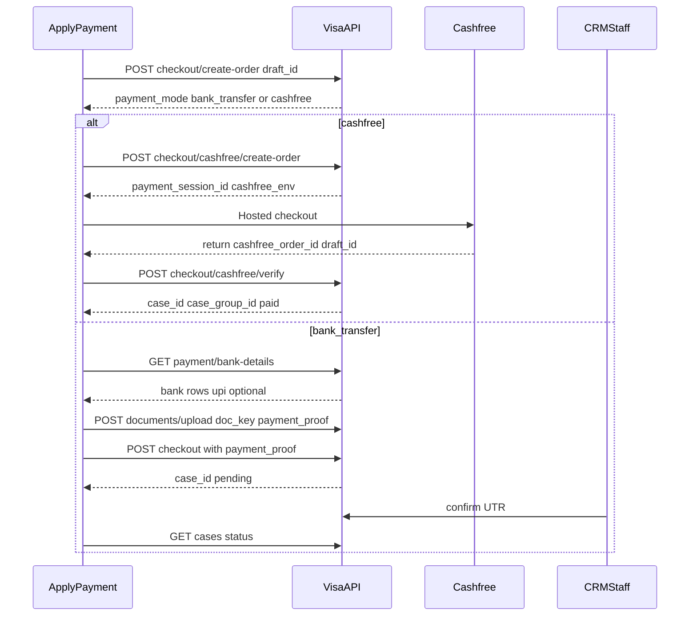

# Customer apply and checkout

Canonical contract for `/apply/[productId]` and post-submit status. Request field lists: [07-payloads-and-models.md](07-payloads-and-models.md). Response shapes: [12-customer-response-shapes.md](12-customer-response-shapes.md).

## URL parameters

| Param | Where | Purpose |
|-------|--------|---------|
| `variant` | `/visa/...` and `/apply/...` | Selected plan id (`variant_id`) |
| `draft` | `/apply/...` | Resume draft id |
| `cashfree_order_id` + `draft_id` | return to `/apply/...` | Cashfree hosted checkout return |
| `mobile_connect=1` + `session_id` | `/apply/...` | Phone QR upload mode (bypass login gate) |

## Step machine

Dynamic steps (skip when empty):

1. **Party** — 1–6 travelers  
2. **Details** — only if product `fields.length > 0` (per traveler)  
3. **Documents** — only if product `documents.length > 0` (per traveler); **omit entire step** when `documents=[]`  
4. **Review**  
5. **Payment** — fees × traveler count  

Rules:

- Passport scan / passport fields only when product includes `passport_scan` (or equivalent passport doc key on the product).
- Required docs listed first; progress counts **required** uploads only.
- Completed stepper steps may jump back; Review offers Edit per section.
- Mobile sticky footer: fee + Back / Save / Continue.

## Draft APIs

| Action | Call |
|--------|------|
| Create | `POST /api/cases` (`CaseDraftIn`) — include `variant_id?` |
| Update | `PATCH /api/cases/drafts/{id}` (`CaseDraftPatchIn`) — JWT **or** `session_id` |
| Get | `GET /api/cases/drafts/{id}` — JWT **or** `session_id` |
| Add / remove traveler | `POST .../travelers`, `DELETE .../travelers/{traveler_id}` |

Omit `variant_id` → server resolves the **default** active plan (single-SKU safe).

## Fees

Unit fees come from the selected plan. Display total = unit × traveler count (plus GST rules used by the client — service GST typically 18%). Changing catalog fees later does **not** change submitted cases (snapshot on checkout).

## Payment — wait then branch

**Do not** render bank receipt or Cashfree button until `POST /api/cases/checkout/create-order` returns.

### Cashfree

- Configured when API has both Cashfree client id and secret.
- Prefer `POST /api/cases/checkout/cashfree/create-order` with `draft_id`, optional `return_url`.
- Verify with `POST /api/cases/checkout/cashfree/verify` (`draft_id`, `order_id`).
- Success → cases `payment_status=paid`.

### Bank transfer

- `GET /api/payment/bank-details` (customer JWT). Fields from **env** — never hardcode account numbers from old release notes.
- Empty `upi_id` → hide QR.
- Upload proof (`doc_key=payment_proof`), then `POST /api/cases/checkout` with `payment_proof`.
- Cases created `payment_status=pending` until staff confirms UTR in CRM.

### create-order response (shared)

Expect at least: `order_id` / identifiers needed for the branch, `payment_mode`, and when Cashfree is on: `payment_session_id`, `cashfree_env` (`sandbox` | `production`). See [12](12-customer-response-shapes.md).

## Mobile upload (QR)

| Rule | Detail |
|------|--------|
| Visibility | **Single traveler only** — hide when party length > 1 |
| Auth | Customer JWT **or** `session_id` query |
| APIs | `POST /api/documents/upload`, `notify-upload`, `GET/POST /api/documents/session/{id}`, `WS /api/documents/ws/{id}` |
| UX | QR CTA above checklist; sticky under site header |

## Status loop (`/status/[caseId]`)

| State | UI |
|-------|-----|
| Pending bank | Pending copy + re-upload via `POST /api/cases/{id}/payment-proof` |
| Proof rejected | Show `payment_proof_rejection`; allow replace |
| Paid | Receipt download `GET /api/cases/{id}/receipt` |
| Family | `sibling_cases` / `case_group` — “Part of family booking (i of N)” |

Document resubmit: `POST /api/cases/{case_id}/documents/{doc_id}/resubmit`.

## Related releases

- [2026-10-05 Cashfree](releases/2026-10-05-cashfree-checkout.md)  
- [2026-09-28 bank payment](releases/2026-09-28-manual-bank-payment.md) (behaviour; use live bank-details API for account fields)  
- [2026-10-05 payment mode flash fix](releases/2026-10-05-payment-mode-flash-fix.md)  
