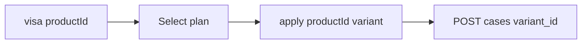

# Customer variants and pricing UI

How the customer site shows multi-validity / multi-price plans. Admin configures plans in CRM; this doc is **customer UI + API usage only**.

## When to show a plan picker

Show an Atlys-style picker **only** when the product has more than one **active** plan:

- `variant_count > 1`, or  
- `variants.filter(v => v.status === 'active').length > 1`

If there is a single plan, keep a simple detail UI (processing / validity / fees from the product or default plan). Do **not** invent a picker.

## Plan = variant

Each plan has:

| Field | Meaning |
|-------|---------|
| `id` | Pass as `variant_id` |
| `label` | Customer-facing name (e.g. `180 Days · Multi-entry`) |
| `validity_days` | How long the visa lasts |
| `max_stay_days` | Max stay per visit |
| `entry_type` | `single` \| `double` \| `multiple` |
| `processing_time_days` | SLA / “Visa in N days” |
| `fees` | `{ govt_fee, service_fee, currency }` |
| `is_default` | Default when `variant_id` omitted |

### Entry type (Multi-entry)

| Value | Customer label | Meaning |
|-------|----------------|---------|
| `single` | Single | One entry |
| `double` | Double | Two entries |
| `multiple` | Multiple / Multi-entry | Enter/leave multiple times within validity |

**Multi-entry is not processing speed.** Processing is a separate field on the same plan.

## Grouping (Express vs Standard on one card)

Group active plans by:

```text
validity_days | entry_type | max_stay_days
```

Plans that share that key but differ in `processing_time_days` (and fees) appear as **one card** with **processing chips** (e.g. Visa in 12 days · price / Visa in 38 days · price).

| Same category? | Keep same |
|-----------------|-----------|
| Validity, entry, max stay | Yes — required for one card |
| Label string | Recommended same; **not** required for grouping |
| Processing + fees | Different per chip |

## Selection flow



1. `GET /api/visa-products/{id}` — optionally `?variant_id=` to overlay fees  
2. User picks a plan → store `variant_id`  
3. Apply CTA → `/apply/{productId}?variant={variant_id}`  
4. `POST /api/cases` / draft patch include `variant_id`  
5. Fee totals and Guaranteed On use that plan’s fees and `processing_time_days`

Omit `variant_id` → API uses the **default** active plan.

## Guaranteed On

`calendar today + processing_time_days` (no weekend / holiday skip). Same formula as case SLA due date.

## Fee transparency

From the fee card, link to:

`/transparency/price-change-log?search={country_code}`

| Column | Source |
|--------|--------|
| Date | `changed_at` |
| **Plan** | `variant_label` (or `—`) |
| Fee Type | `govt_fee` / `service_fee` |
| From / To / Difference | amounts |
| Reason | public fee-change reason (min 10 chars when staff save) |

API: `GET /api/visa-products/fee-change-log` (`country` / `search` / `q`).

## Accessibility

Do **not** nest a processing chip `<button>` inside a group `<button>`. Use a focusable group container (`div` + `role="button"` + keyboard) with real `<button>` chips inside.

## Related

- Migration: every product gets one default plan on deploy (`015`) without changing fee amounts  
- Release: [2026-11-27 visa product variants](releases/2026-11-27-visa-product-variants.md)  
- Shapes: [12-customer-response-shapes.md](12-customer-response-shapes.md)  
